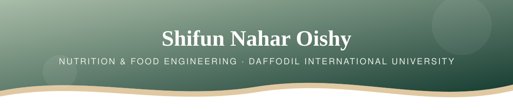

<i>Curious about food, health and science 🌱 · Future researcher in nutrition 🔬 · Artist at heart 🎨</i>

  
  
  

---

### 🌿 About me

> 🎓 First-year BSc student in **Nutrition and Food Engineering** at **Daffodil International University**, Bangladesh 
> 🔬 Interested in **public health nutrition** and **food safety** 
> 🎨 Amateur artist who loves drawing and painting 

### 🌱 Currently growing

- 📚 Building strong foundations in my first semester
- 🗣️ Practising presentations in English
- 📊 Learning academic writing and data analysis

### 🧰 Toolkit

  
  
  
  
  
  
  

---

<i>“Good research begins with thoughtful questions.”</i>

